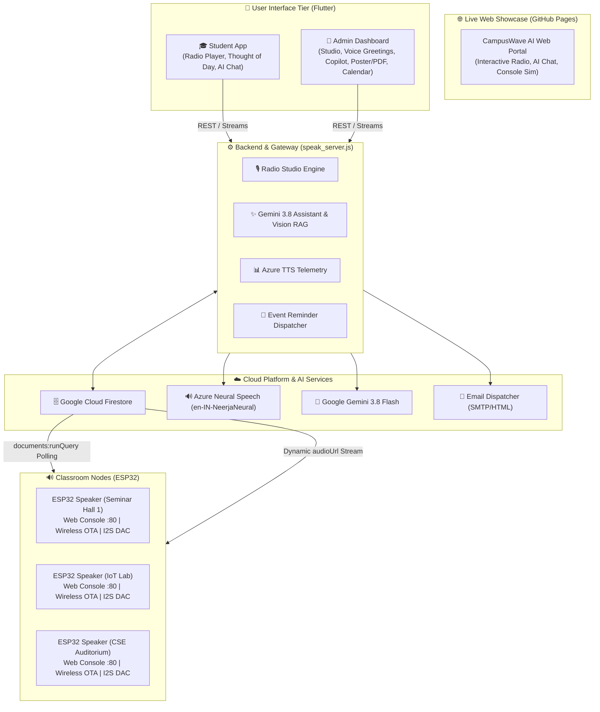

# 📻 AI-Powered Campus Radio & Smart Announcement System

An enterprise-grade AI and IoT ecosystem for automated campus-wide voice announcements, daily campus radio studio programming, dynamic System Voice Greetings management, Google Gemini 3.8 Flash RAG assistance, multimodal circular/poster digitization, and decentralized ESP32 I2S hardware speaker nodes with embedded zero-heap Web Consoles and wireless Over-The-Air (OTA) firmware updates.

🌐 **Live Interactive Web Showcase (GitHub Pages):** [https://sirim2027-lab.github.io/AI_Powered_Campus_Radio_Flutter/](https://sirim2027-lab.github.io/AI_Powered_Campus_Radio_Flutter/)

**Built With:** Flutter (Mobile/Web/Desktop) • Google Cloud Firestore • Google Gemini 3.8 Flash • Azure Cognitive Neural TTS • ESP32 FreeRTOS I2S Firmware

---

## 📑 Complete Documentation Suite

Detailed technical guides, schematics, runbooks, and API manuals are available in the [`docs/`](file:///Users/junaid/Desktop/AT/Announcement-system/docs) directory:

1. 🏛️ **[System Architecture & Technical Design Specification](file:///Users/junaid/Desktop/AT/Announcement-system/docs/system_architecture_and_design.md)**: End-to-end component hierarchy, data models, state synchronization, and sequence diagrams.
2. 📡 **[REST API Reference Manual](file:///Users/junaid/Desktop/AT/Announcement-system/docs/api_reference.md)**: Complete endpoint catalog, request/response schemas, query parameters, error codes, and curl examples.
3. 🛠️ **[Hardware Engineering & ESP32 Firmware Guide](file:///Users/junaid/Desktop/AT/Announcement-system/docs/hardware_and_firmware_guide.md)**: Hardware BOM, pinout mapping, I2S DAC schematics, FreeRTOS state machines, Dual-OTA partitions, and zero-heap PROGMEM Web Console.
4. 🚀 **[Production Deployment & Operations Runbook](file:///Users/junaid/Desktop/AT/Announcement-system/docs/deployment_and_operations_guide.md)**: Deployment procedures (PM2/Systemd/Docker/Firebase), quota management, and backup/failover runbooks.
5. 🧠 **[AI RAG & Multimodal Intelligence Pipeline](file:///Users/junaid/Desktop/AT/Announcement-system/docs/ai_rag_and_multimodal_pipeline.md)**: Gemini 3.8 Flash RAG grounding, prompt design, multimodal poster OCR, and Azure Neural TTS tuning.
6. 🚀 **[ESP32 First-Time Flashing & Firmware Upload Guide](file:///Users/junaid/Desktop/AT/Announcement-system/docs/esp32_first_time_flashing_guide.md)**: Step-by-step Arduino IDE & PlatformIO CLI guide with driver links and partition configuration.
7. 📶 **[ESP32 Dual-Mode Wi-Fi Provisioning & Wireless OTA Guide](file:///Users/junaid/Desktop/AT/Announcement-system/docs/wifi_provisioning_guide.md)**: Port 80 Web Console (`admin` / `CampusAdmin@2026`), 30s autonomous SoftAP fallback, and browser-based OTA flashing.

---

## 🌟 Core System Capabilities

### 1. 🎙️ Automated Campus Radio Studio Engine & System Voice Greetings
* **Morning Chronicle (08:30 AM IST):** Campus greeting, dynamic **Thought of the Day**, daily timetable notices, and upcoming academic deadlines.
* **Mid-Day Campus Pulse (01:15 PM IST):** Real-time placement drives, hackathon cutoffs, internships, and urgent afternoon alerts.
* **Evening Preview (04:30 PM IST):** Next-day schedule preview, lab preparations, and 48-hour event outlook.
* **Department Audio Hub (`/dept/:code.mp3`):** High-clarity Indian English neural voice (`en-IN-NeerjaNeural`) for entrance kiosks and in-app streaming.
* **System Voice Greetings Manager (Admin Tab):** Customizable first-time hardware registration greetings, time-of-day power-on announcements (Morning/Afternoon/Evening), template token substitution (`{college}`, `{classroom}`), and live cloud **Listen Preview** testing.

### 2. 🤖 Google Gemini 3.8 Flash AI Assistant & Admin Copilot (RAG Grounded)
* **Student Campus Assistant:** Text + Voice interactive query resolution covering notices, HODs, faculty, lab equipment, syllabus, and radio broadcast schedules.
* **Admin AI Copilot:**
  * **One-Click Announcement Drafter:** Generates structured announcements (Title, Category, Priority, Department, Message) ready to publish.
  * **Student Query Summarizer:** Synthesizes open support tickets from Firestore and suggests actions.
  * **Hardware Diagnostics:** Reports registered classrooms, online heartbeat statuses, and ESP32 MAC address mappings.

### 3. 📄 Image & PDF Processing ➔ Voice Announcements
* **Poster & Flyer OCR:** Gemini 3.8 Multimodal Vision extracts event titles, dates, venues, eligibility, and rules from uploaded images.
* **Official PDF Circular Parser:** Parses multi-page circulars in the cloud and creates structured administrative summaries.
* **Automated Audio Conversion:** Translates extracted documents into a 30-second spoken radio script, synthesizes MP3 audio via Azure Neural TTS, and queues it directly for classroom speakers.

### 4. 📅 Multi-Channel Broadcasting & Event Calendar Reminders
* **Academic Calendar:** Firestore collection (`events_calendar`) tracking exams, placement drives, hackathons, and registration cutoffs.
* **3-Channel Automated Reminders:**
  * **📻 Campus Radio:** Injects upcoming deadlines into daily radio broadcasts.
  * **📧 Automated Email Reminders:** Dispatches formatted HTML reminder alerts to registered student emails.
  * **📱 In-App Alert Banners:** Syncs urgent notifications to the mobile/web dashboard.

### 5. 📊 Azure Neural TTS Quota & Telemetry Engine
* Real-time monitoring of monthly character usage against Azure Free Tier (500,000 chars/month).
* Tracks cached character savings, request success rates, and per-feature consumption.

### 6. 🔊 ESP32 Hardware, In-Speaker Web Console & Wireless OTA Updates
* **Pure Firestore URL Resolution:** Firmware decodes audio directly from Firestore announcement documents without hardcoded backend hostnames.
* **Embedded Password-Protected Web Console (`http://<speaker-ip>`):** Configure Wi-Fi or reboot without opening the speaker box (HTTP Auth: `admin` / `CampusAdmin@2026`).
* **Wireless Over-The-Air (OTA) Updates (`/update`):** Upload new `firmware.bin` directly through the web browser. The ESP32 flashes itself in 10s and auto-reboots.
* **Autonomous SoftAP Watchdog:** Automatically spawns emergency Wi-Fi hotspot (`CampusRadio-Speaker-XXXX` on `192.168.4.1`) if campus Wi-Fi drops for > 30s.
* **Zero-Heap ROM Storage (`PROGMEM`):** HTML console resides in Flash ROM, keeping RAM usage at 15.8% (>84% free RAM for MAX98357A I2S DMA audio buffering).

---

## 🏗️ End-to-End System Block Diagram



---

## 📡 REST API Quick Reference

| Endpoint | Method | Description |
| :--- | :---: | :--- |
| `/health` | `GET` | Service status, Azure Speech connectivity probe, and voice info |
| `/thought-of-the-day.mp3` | `GET` | Streams synthesized MP3 of today's inspirational thought |
| `/dept/:code.mp3` | `GET` | Continuous departmental audio stream (e.g. `/dept/CSE.mp3`) |
| `/radio/preview/:showType` | `GET` | Previews script for `morning`, `afternoon`, `evening`, or dept |
| `/radio/trigger/:showType` | `POST` | Triggers instant live broadcast to classroom speakers |
| `/api/student/chat` | `POST` | Student AI Campus Assistant (Gemini 3.8 Flash RAG) |
| `/api/admin/chat` | `POST` | Admin AI Copilot (Announcement drafter, query insights) |
| `/api/process/image` | `POST` | Multimodal OCR of event poster image to radio script |
| `/api/process/pdf` | `POST` | PDF circular extraction & voice announcement generator |
| `/api/process/publish-to-radio` | `POST` | Publishes extracted document directly to speaker queue |
| `/api/events` | `GET` | Lists academic calendar events & deadlines |
| `/api/events` | `POST` | Creates a new calendar event |
| `/api/events/trigger-reminders` | `POST` | Dispatches multi-channel email & radio reminders |
| `/telemetry/azure-tts` | `GET` | Live Azure TTS quota usage, character counts & health |

---

## 📁 Repository Directory Structure

```
Announcement-system/
├── .github/workflows/                 # Automated CI/CD & GitHub Pages Deployment
│   └── deploy_gh_pages.yml            # Auto-deploys docs/ to GitHub Pages
│
├── admin_app/                         # Flutter Mobile, Web, and Desktop Application
│   ├── lib/
│   │   ├── admin/                     # Admin dashboard, Studio, Voice Greetings & Management
│   │   ├── student/                   # Student dashboard & interactive player
│   │   ├── features/student/screens/
│   │   │   └── chatbot/               # AI Campus Assistant & Voice Screen
│   │   ├── models/                    # AppUser, Announcement, Calendar data models
│   │   └── services/                  # FirestoreService, Audio & Preview Services
│   └── test/                          # Unit & E2E Flutter test suite (17/17 Passing)
│
├── backend/                           # Node.js Microservices & AI Engines
│   ├── gemini_assistant.js            # Gemini 3.8 Flash RAG engine (Student + Admin)
│   ├── doc_processor.js               # Gemini Multimodal Vision & PDF extraction
│   ├── event_reminder_engine.js       # Calendar manager & multi-channel dispatcher
│   ├── radio_engine.js                # Morning, afternoon, and evening studio engine
│   ├── tts_telemetry.js               # Azure Speech 500k quota & usage tracking
│   ├── seed_radio_data.js             # Initializer for departments and thoughts
│   ├── firestore.rules                # Hardened Firestore security rules
│   └── gemini_config.json             # Gemini model and API key configuration
│
├── docs/                              # Production Documentation & GitHub Pages Showcase
│   ├── index.html                     # Live interactive web application showcase
│   ├── app.css                        # Glassmorphic dark mode styling
│   ├── app.js                         # Live audio player & AI chat simulator
│   ├── system_architecture_and_design.md
│   ├── api_reference.md
│   ├── hardware_and_firmware_guide.md
│   ├── deployment_and_operations_guide.md
│   ├── ai_rag_and_multimodal_pipeline.md
│   ├── esp32_first_time_flashing_guide.md
│   └── wifi_provisioning_guide.md
│
├── firmware/worker/                   # ESP32 C++ I2S Speaker Firmware (PlatformIO & Arduino IDE)
│   ├── src/main.cpp                   # I2S MP3 streaming, Web Console :80 & OTA updates
│   ├── worker.ino                     # Arduino IDE synchronized source
│   ├── partitions_ota.csv             # Dual 1.875MB OTA partition table
│   └── platformio.ini                 # Build configurations
│
├── speak_server.js                    # Core API Gateway & Azure TTS Proxy Server
├── scripts/                           # System health audits & concurrent load tests
└── README.md                          # Master project documentation
```

---

## 🚀 Quick Start Guide

### 1. View the Live GitHub Pages Web Showcase
Visit [https://sirim2027-lab.github.io/AI_Powered_Campus_Radio_Flutter/](https://sirim2027-lab.github.io/AI_Powered_Campus_Radio_Flutter/) to experience the interactive radio player, Gemini AI assistant, and in-speaker Web Console simulator.

### 2. Launch the Backend Gateway
```bash
node speak_server.js
```

### 3. Launch the Flutter Application
```bash
cd admin_app
flutter run -d chrome    # Web Browser
flutter run -d macos     # Desktop macOS
flutter run -d android   # Connected Android Device / Emulator
```

### 4. Run Automated Validation & Health Audits
```bash
npm run test:full        # Executes 21-point system health audit + 10x concurrent TTS stress test
```
