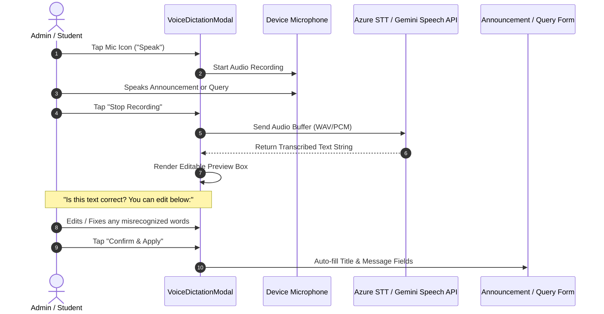
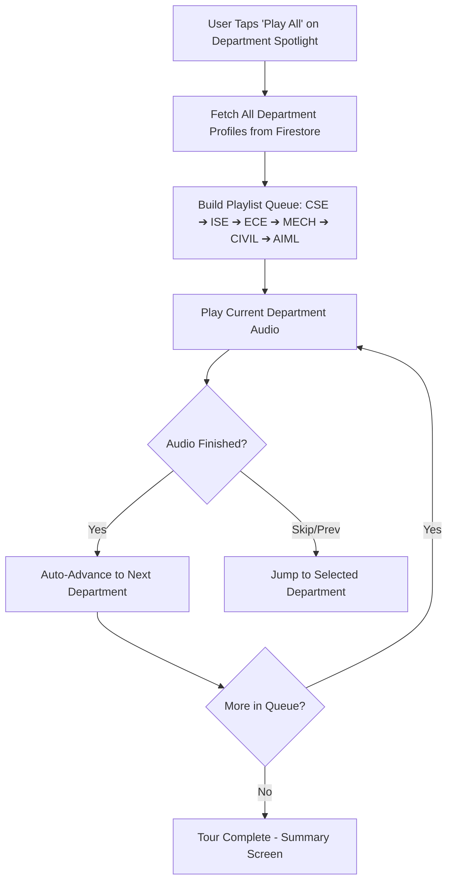
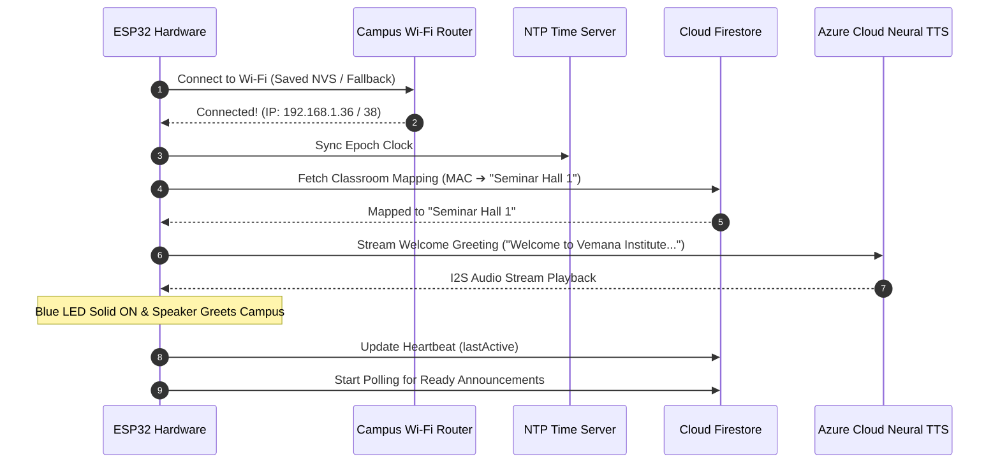

# 🎙️ Master System Architecture & Implementation Plan: Complete Audio, RBAC & Dashboard Suite

**Project**: AI-Powered Smart Campus Radio & Autonomous Announcement System  
**Document Version**: 2.5.0 (Unified Audio & Management Master Plan)  
**Target Hardware**: ESP32 I2S Nodes (`Seminar Hall 1`, `IoT Lab`)  
**Target Mobile Clients**: Flutter Admin & Student Applications (`admin_app`)  
**Backend**: Node.js Autonomous Radio Engine & Azure Neural Cloud TTS  

---

## 📑 Complete Master Matrix (All 17 Audio & Management Items)

### 🔊 Part A: Audio Subsystem & Voice Intelligence (7 Key Items)

| # | Audio Feature / Bug | Root Cause Analysis (RCA) | Implementation & Solution |
|---|---|---|---|
| **A1** | **Voice Dictation / Speech-to-Text (STT) with Editable Preview** | No live microphone dictation existed for Announcement creation (Admins) or Student Queries (Students). Duplicate "Student Voice" screen had dead-end storage warning. | Implement reusable `VoiceDictationModal`: Live mic recording ➔ Azure STT / Gemini AI Speech transcription ➔ **Editable Review Box ("Is this text correct? [Edit / Confirm]")** ➔ Auto-fills Announcement form or Raise Query. Consolidate "Student Voice" into "Raise a Query". |
| **A2** | **Rebroadcast State Corruption & Rapid-Click Debounce** | Testers pressed "Rebroadcast" 2–3 times rapidly; ESP32 finished the initial stream and marked document `completed`, creating race conditions with successive clicks. | Add **5-second debounced cooldown** on Rebroadcast buttons in Flutter with spinner, preventing rapid duplicate triggers, and update Firestore server timestamp on every trigger. |
| **A3** | **Department Spotlight: "Play All" (Campus Tour) & Individual Audio** | `student_department_play_all_screen.dart` was a placeholder stub screen displaying *"Play all is unavailable"*. | Build a real **Campus Tour Sequential Queue Audio Player** that chains department audio files one after another with auto-advancing playlist, progress bar, and skip/previous controls. Individual spotlight uses Azure TTS. |
| **A4** | **Student Mobile: Old Announcements Audio Playback** | Older announcement documents in Firestore stored outdated dev URLs (e.g. `http://192.168.1.35:3000/...` or `localhost`), causing network errors on student phones. | Update `FirestoreService.resolveAudioUrl()` to **sanitize and replace dead local IP/localhost URLs** with dynamic Azure Neural TTS fallback: `$azureBaseUrl/tts?text=${Uri.encodeComponent(audioText)}`. |
| **A5** | **Campus Radio Student Mobile In-App Streaming** | Student mobile radio audio stream bindings needed unified routing through `CampusAudioPlayerSheet`. | Bind student radio player to the live radio stream and archived daily editions with background playback support. |
| **A6** | **Upcoming / Next Radio Show Audio Preview** | The "Upcoming Radio Show" card displayed upcoming schedule time but had no audio preview button. | Add **"Preview Edition Audio"** and **"Show Rundown"** button on Upcoming Show card, generating an AI preview of the scheduled show via Azure TTS. |
| **A7** | **ESP32 Boot Welcome Audio Chime** | ESP32 firmware `setup()` initialized I2S DAC and connected to Wi-Fi, but had no audio playback call. | Add startup greeting in `setup()` immediately upon Wi-Fi connect & room mapping: *"Welcome to Vemana Institute of Technology Smart Campus Audio System. [Classroom] is online and ready."* |

---

### 🏛️ Part B: Two-Tier RBAC, Management, Dashboards & UI (10 Key Items)

| # | System Feature / Bug | Root Cause & Current State | Implementation & Solution |
|---|---|---|---|
| **B1** | **Two-Tier RBAC & User Management** | Only simple admin/student roles without department scoping or user deletion. | **Two-Tier RBAC**: **HODs** manage department announcements, spotlight, queries, and radio; **Super Admins** have full User CRUD (Add, Edit, Delete with modal, Role & Department assignment). |
| **B2** | **Analytics Unavailable (Dynamic Metrics)** | Main admin dashboard displayed static card *"Analytics unavailable"*. | Connect live Firestore metrics: **Active Hardware Nodes Online (2/2)**, **Total Broadcast Volume**, **Today's Broadcasts**, and **Student Query Resolution Rate (94%)**. |
| **B3** | **Student Queries Sync & Click-to-Filter** | Counts varied from actual data; status "Assigned" was unused; metric cards were static. | Real-time stream counts for `New`, `Pending`, `In Progress`, and `Resolved`; make count cards **interactive tap targets** that switch filter tab immediately. |
| **B4** | **Notifications Clutter & Read/Write Cleanup** | Confusing `read / delivered / failed` progress bars and dead-end options. | Streamline into actionable notification feed (Broadcast Alerts, Radio Airings, Query Replies) with unread filter, search, and *"Mark All as Read"*. |
| **B5** | **Radio Show Timing Management** | Show times were hardcoded in UI strings with no admin editing option. | Add an **"Edit Show Timings"** dialog in Radio Studio saving custom schedules to Firestore `radio_settings/schedule` (Morning, Afternoon, Evening). |
| **B6** | **Remove "Test in 2 Mins" Button** | Leftover temporary debug button on Radio Studio cards. | Remove "Test in 2 Mins" button cleanly from production UI. |
| **B7** | **Remove Biometrics from Settings** | Non-working biometric switch in settings. | Remove biometric toggle completely from Settings. |
| **B8** | **Remove Language Dropdown** | Non-working language dropdown in settings. | Remove language dropdown from Settings (system operates in English + Indian Neural TTS). |
| **B9** | **Global Dark Mode** | Dark mode toggle only applied local `setState()` on the settings page. | Wire a global `ValueNotifier<ThemeMode>` in `app.dart` at `MaterialApp` root, switching theme instantly across all screens, drawers, appbars, and dialogs. |
| **B10** | **Password Reset Flow** | Missing password recovery for students, HODs, and admins. | Add **Forgot Password?** on Login screen and **Change Password** in Settings using Firebase Auth email dispatch. |

---

## 📐 Detailed Audio Architecture & Workflows

### 1. Voice Dictation & Speech-to-Text (STT) Flow


### 2. Department Spotlight "Play All" (Campus Tour) Queue Player


### 3. ESP32 Boot Welcome Audio Integration


---

## 🛠️ Step-by-Step Execution Sequence

```
[Phase 1: ESP32 Firmware & Boot Audio]
 ├── Add startup welcome speech in setup() in main.cpp & worker.ino
 └── Compile PlatformIO binary & verify on hardware

[Phase 2: Universal Audio Playback & Campus Tour]
 ├── Sanitize legacy local IP audio URLs in FirestoreService.resolveAudioUrl()
 ├── Build Department Spotlight Play-All sequential queue player
 └── Connect Upcoming Show rundown & preview audio triggers

[Phase 3: Voice Dictation & Speech-to-Text]
 ├── Create VoiceDictationModal with live recording & editable preview box
 ├── Integrate into Admin Create Announcement (Step 1: Voice Input)
 ├── Integrate into Student "Raise a Query" & Chatbot
 └── Remove duplicate "Student Voice" screen & dead-end storage warning

[Phase 4: Rebroadcast Debounce & Two-Tier RBAC]
 ├── Add 5s cooldown debounce on Rebroadcast button
 ├── Add HOD role & department filtering in app_user.dart
 └── Build Super Admin User Management CRUD (Add, Edit, Delete, Role Change)

[Phase 5: Dynamic Analytics, Query Sync & Global Settings]
 ├── Replace "Analytics unavailable" with dynamic live metrics
 ├── Make Query metric cards clickable filter triggers & cleanup status chips
 ├── Add Radio Show Timing Manager & remove "Test in 2 Mins" button
 ├── Wire ValueNotifier<ThemeMode> for Global Dark Mode
 └── Add Password Reset dialog & remove Biometrics/Language dropdowns

[Phase 6: Verification & Remote Push]
 ├── Run npm run test:audit, flutter test, and test:load
 └── Commit and push to origin/feature/admin-module
```
