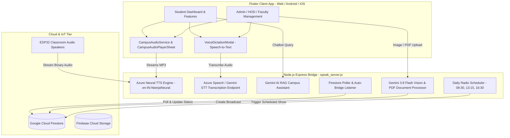
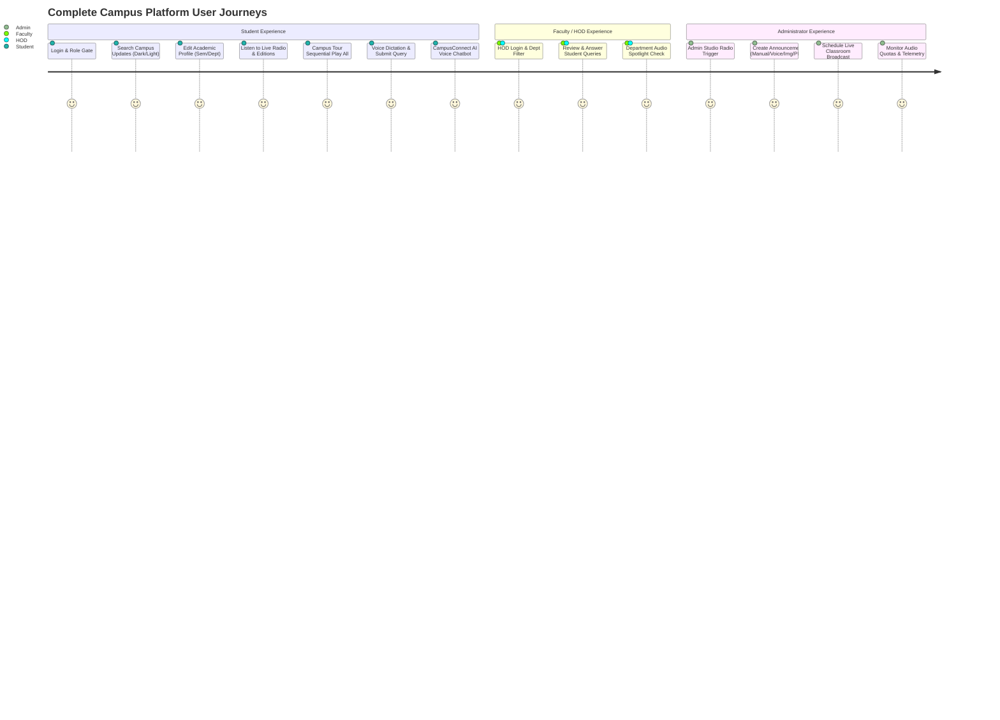
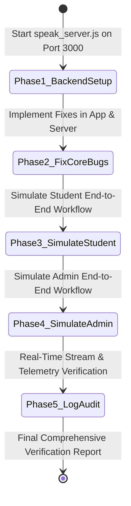

# Comprehensive System Architecture, Workflow & Rigorous End-to-End Test Plan

**Project:** AI-Powered Campus Radio & Smart Announcement Platform  
**Target Roles:** Students, Faculty, Department HODs, System Administrators  
**Date:** October 2026  

---

## 1. Executive System Architecture & Codebase Map

The platform comprises an integrated multi-tier ecosystem delivering real-time voice, text, document intelligence, and IoT broadcast automation.

---

## 2. Deep-Dive Root-Cause Analysis of Reported Bugs

### Bug 1 & 2: Audio Transcription (STT) Failing Across All Modules
* **Affected Areas:**
  1. Student Query Voice Dictation ([`student_raise_query_screen.dart`](file:///Users/junaid/Desktop/AT/Announcement-system/admin_app/lib/features/student/screens/student_raise_query_screen.dart))
  2. Student CampusConnect Chatbot ([`student_campus_assistant_screen.dart`](file:///Users/junaid/Desktop/AT/Announcement-system/admin_app/lib/features/student/screens/chatbot/student_campus_assistant_screen.dart))
  3. Admin / HOD / Faculty Announcement Dictation ([`admin_management_pages.dart`](file:///Users/junaid/Desktop/AT/Announcement-system/admin_app/lib/admin/admin_management_pages.dart))
  4. Admin Copilot Chatbot (`StudentCampusAssistantScreen(isAdmin: true)`)
* **Root Cause:**
  - `VoiceDictationModal` in [`voice_dictation_modal.dart`](file:///Users/junaid/Desktop/AT/Announcement-system/admin_app/lib/widgets/voice_dictation_modal.dart) was sending HTTP POST requests to `${FirestoreService.azureBaseUrl}/stt/transcribe`.
  - The endpoint `/stt/transcribe` was **completely missing** in [`speak_server.js`](file:///Users/junaid/Desktop/AT/Announcement-system/speak_server.js).
  - The `catch (_)` block silently swallowed the 404/500 network failure, leaving `_textController.text` empty.
  - The UI transitioned directly to `DictationState.reviewing` showing *"Transcription complete!"* but with an empty text area (`"Transcribed text will appear here..."`) as evidenced in **Screenshot 1**.
  - No native Web Speech API or microphone audio fallback existed.

---

### Bug 3: Search Bar & Text Field Character Invisibility in Dark/Light Themes
* **Affected Areas:**
  1. Student Dashboard Search Bar ([`student_dashboard.dart`](file:///Users/junaid/Desktop/AT/Announcement-system/admin_app/lib/student/student_dashboard.dart))
  2. Student Academic Profile Editor ([`student_edit_profile_screen.dart`](file:///Users/junaid/Desktop/AT/Announcement-system/admin_app/lib/features/student/screens/student_edit_profile_screen.dart))
  3. Search Dialogs and Admin Form Inputs ([`admin_management_pages.dart`](file:///Users/junaid/Desktop/AT/Announcement-system/admin_app/lib/admin/admin_management_pages.dart))
* **Root Cause:**
  - **Student Dashboard Search Bar (Screenshot 3):**
    - The global `AppTheme.light` `InputDecorationTheme` forces `filled: true, fillColor: Colors.white`.
    - The `TextField` in `student_dashboard.dart` hardcoded `style: const TextStyle(color: Colors.white)`.
    - Result: White text rendered inside a solid white input box on light mode, making characters invisible and leaving only an underline or grey cursor (`___________`).
  - **Edit Academic Profile Screen (Screenshot 2):**
    - `student_edit_profile_screen.dart` used a white card container (`color: Colors.white`) with light grey field backgrounds (`Color(0xFFF9FAFB)`).
    - When dark theme is active, `Theme.of(context).textTheme.bodyLarge` defaults to white/light text.
    - Result: White text on light fields rendered the student's name (*"Siri M"*), USN (*"1VE23CD055"*), Semester, and Department completely invisible.

---

### Bug 4: Mobile Campus Radio & Announcements Audio Playback Unavailable
* **Affected Areas:**
  1. Student Morning Brief ([`student_morning_brief_screen.dart`](file:///Users/junaid/Desktop/AT/Announcement-system/admin_app/lib/features/student/screens/radio/student_morning_brief_screen.dart))
  2. Student Day-End Bulletin ([`student_day_end_bulletin_screen.dart`](file:///Users/junaid/Desktop/AT/Announcement-system/admin_app/lib/features/student/screens/radio/student_day_end_bulletin_screen.dart))
  3. Student Career Placement Audio ([`student_career_placement_screen.dart`](file:///Users/junaid/Desktop/AT/Announcement-system/admin_app/lib/features/student/screens/radio/student_career_placement_screen.dart))
  4. Student Full Radio Player Screen ([`student_full_radio_player_screen.dart`](file:///Users/junaid/Desktop/AT/Announcement-system/admin_app/lib/features/student/screens/radio/student_full_radio_player_screen.dart))
* **Root Cause:**
  - `StudentFullRadioPlayerScreen` was a hardcoded static placeholder containing:
    `"Playback is unavailable. This project has no verified Campus Radio stream or audio URL..."` (**Screenshot 4**).
  - Navigation buttons inside the morning brief, day-end bulletin, and placement screens routed directly to this static stub instead of triggering [`CampusAudioService`](file:///Users/junaid/Desktop/AT/Announcement-system/admin_app/lib/widgets/in_app_audio_player.dart) or `CampusAudioPlayerSheet`.
  - Live audio URLs like `/radio/stream/morning`, `/radio/stream/afternoon`, and `/radio/stream/evening` were not wired into the full player screen.

---

### Bug 5: Campus Tour & Department Info "Play All" Sequential Playback
* **Affected Areas:**
  1. Student Department Play All Tour ([`student_department_play_all_screen.dart`](file:///Users/junaid/Desktop/AT/Announcement-system/admin_app/lib/features/student/screens/department/student_department_play_all_screen.dart))
  2. Department Audio Spotlights ([`student_department_spotlight_screen.dart`](file:///Users/junaid/Desktop/AT/Announcement-system/admin_app/lib/features/student/screens/department/student_department_spotlight_screen.dart), [`student_department_details_screen.dart`](file:///Users/junaid/Desktop/AT/Announcement-system/admin_app/lib/features/student/screens/department/student_department_details_screen.dart))
* **Root Cause:**
  - In `student_department_play_all_screen.dart`, while a queue list was designed (**Screenshot 5**), sequential playback transitions experienced state desynchronization between `Audioplayers` completion callbacks, Azure Neural TTS buffering delays, and auto-advance timers.
  - Department scripts required proper URL encoding and fallback handling when switching between dynamic Firestore records and fallback department items.

---

### Bug 6: Document / Image / PDF Text Extraction for Announcement Creation
* **Affected Areas:**
  1. Admin Create Announcement - Step 1: Input Method (`AnnouncementInputMethodPage` in [`admin_management_pages.dart`](file:///Users/junaid/Desktop/AT/Announcement-system/admin_app/lib/admin/admin_management_pages.dart))
  2. Poster OCR & Circular PDF Processing ([`poster_ocr.dart`](file:///Users/junaid/Desktop/AT/Announcement-system/admin_app/lib/services/poster_ocr.dart), [`doc_processor.js`](file:///Users/junaid/Desktop/AT/Announcement-system/backend/doc_processor.js))
* **Root Cause:**
  - When selecting `PDF / Document` (Method 2), the file picker was omitted, and the flow directly transitioned to Step 2 with an empty string.
  - When selecting `Image / Poster` (Method 1), native OCR plugins (`flutter_ocr_native` / `flutter_tesseract_ocr`) were called with varying platform incompatibilities instead of channeling the image bytes directly to backend Gemini Multimodal Vision (`/api/process/image`), which extracts structured titles, key dates, summaries, and radio broadcast scripts.

---

## 3. End-to-End User Workflows (All Roles & Test Cases)

---

### User Persona 1: Student Workflow Matrix

| # | Step / Feature | Positive Test Case | Negative / Edge Test Case | Expected Result |
|---|---|---|---|---|
| **S1** | **Authentication & Role Session** | Student logs in with verified institutional credentials (`sirim.ds2023@vemanait.edu.in`). | Invalid email/password, unassigned student role. | Profile gate loads student dashboard; errors display actionable alerts without crash. |
| **S2** | **Theme Switch & Search Bar** | Toggle between Light and Dark mode; type keyword in search box. | Special characters, rapid backspace, empty search. | Search bar text is crisply visible in both Light and Dark themes (no white-on-white or `___` artifacts). |
| **S3** | **Edit Academic Profile** | Edit Full Name, USN (`1VE23CD055`), promote semester (`7th Semester`), select department. | Empty full name, invalid USN format. | Form fields show black/dark text on light inputs in dark & light themes. Firestore merges profile and shows success snackbar. |
| **S4** | **Campus Radio Streaming** | Click "Listen Live", Morning Brief, Mid-Day Pulse, Evening Wrap-up. | Offline stream, intermittent network loss. | `CampusAudioPlayerSheet` opens, audio streams smoothly from Azure Neural TTS with playback rate and seek controls. |
| **S5** | **Campus Tour "Play All"** | Click "Campus Tour (Play All)"; listen to CSE, ISE, ECE in sequence. | Pause midway, manual skip to next dept, toggle auto-advance OFF/ON. | Player plays current dept, highlights active item in queue (Screenshot 5), automatically advances to next dept upon completion. |
| **S6** | **Voice Dictation Query** | Tap mic in "Raise Query", speak query, view transcription, edit text in modal, confirm & submit. | Background noise, mic permission denied, clearing transcribed text. | Voice dictation modal accurately populates transcribed text, allows student edits, applies text to query fields and stores in Firestore. |
| **S7** | **CampusConnect AI Assistant** | Ask chatbot via text or voice mic; click "Listen to Answer". | Out-of-domain query, prompt injection, empty input. | Chatbot replies with grounded campus information; Azure TTS reads answer cleanly aloud. |

---

### User Persona 2: Faculty & HOD Workflow Matrix

| # | Step / Feature | Positive Test Case | Negative / Edge Test Case | Expected Result |
|---|---|---|---|---|
| **F1** | **HOD Login & Inbox** | HOD logs in; views department queries (e.g. ISE / CSE queries). | Query from another department. | Role-based security filters queries relevant to HOD's department. |
| **F2** | **Query Resolution & Reply** | HOD updates query status from "Open" -> "In Progress" -> "Resolved" with remarks. | Submitting empty remarks. | In-app notification and email trigger dispatched to student. |
| **F3** | **Department Audio Kiosk** | HOD previews department audio spotlight narration script. | Custom announcements missing. | Azure Neural TTS generates department overview, HOD bio, and achievements. |

---

### User Persona 3: Administrator Workflow Matrix

| # | Step / Feature | Positive Test Case | Negative / Edge Test Case | Expected Result |
|---|---|---|---|---|
| **A1** | **Admin Dashboard & Studio** | Admin launches Campus Radio Studio; triggers instant Morning/Afternoon radio show. | Triggering when no notices exist. | Studio generates dynamic script with Thought of the Day, pushes to Firestore, broadcasts to classroom speakers. |
| **A2** | **Announcement - Manual Text** | Enter title, message, category, target dept, and schedule time. | Empty title, past timestamp. | Validated announcement created and auto-promoted to 'ready' with TTS audio URL. |
| **A3** | **Announcement - Voice Input** | Select "Voice Input" in Step 1, dictate announcement, review/edit text, confirm & publish. | Re-recording, canceling modal. | Transcribed text populates title and description in Step 2; announcement broadcasts with synthesized audio. |
| **A4** | **Announcement - Image/Poster** | Upload event flyer image; Gemini vision extracts title, date, venue, summary & radio script. | Low-resolution image, unreadable poster. | Fields auto-populated in Step 2; admin can edit before publishing. |
| **A5** | **Announcement - PDF Circular** | Upload official PDF circular; Gemini extracts circular subject, rules, deadlines & script. | Corrupted PDF, password-protected PDF. | Structured extraction populates announcement form; direct publish to radio queue available. |
| **A6** | **IoT Speaker Management** | Select target classrooms (`Seminar Hall 1`, `IoT Lab`), test broadcast audio ping. | Disconnected speaker node. | Telemetry logs request; audio streams with low latency. |

---

## 4. Rigorous Step-by-Step Simulation & Verification Strategy

### Simulation Execution Plan

### Actionable Implementation Tasks

1. **Backend ([`speak_server.js`](file:///Users/junaid/Desktop/AT/Announcement-system/speak_server.js) & [`doc_processor.js`](file:///Users/junaid/Desktop/AT/Announcement-system/backend/doc_processor.js)):**
   - Add `/stt/transcribe` and `/api/stt/transcribe` endpoints supporting audio transcription (Azure Speech STT & Gemini multimodal audio processing) with graceful fallback.
   - Wire `/api/process/image` and `/api/process/pdf` directly for announcement creation.
   - Verify all radio show stream endpoints (`/radio/stream/morning`, `/afternoon`, `/evening`, `/dept/:code.mp3`).

2. **Frontend UI & Theming (`admin_app/lib`):**
   - Fix [`student_dashboard.dart`](file:///Users/junaid/Desktop/AT/Announcement-system/admin_app/lib/student/student_dashboard.dart) search bar theming: explicitly style `TextField` with high-contrast text color and adaptive fill color.
   - Fix [`student_edit_profile_screen.dart`](file:///Users/junaid/Desktop/AT/Announcement-system/admin_app/lib/features/student/screens/student_edit_profile_screen.dart) input field contrast: ensure dark text styles on white fields or dynamic theme-adaptive colors.
   - Upgrade [`voice_dictation_modal.dart`](file:///Users/junaid/Desktop/AT/Announcement-system/admin_app/lib/widgets/voice_dictation_modal.dart): integrate robust STT API communication, interactive editing, and reliable transcription confirmation.
   - Replace [`student_full_radio_player_screen.dart`](file:///Users/junaid/Desktop/AT/Announcement-system/admin_app/lib/features/student/screens/radio/student_full_radio_player_screen.dart) placeholder with an interactive live radio player connected to [`CampusAudioService`](file:///Users/junaid/Desktop/AT/Announcement-system/admin_app/lib/widgets/in_app_audio_player.dart).
   - Enhance [`student_department_play_all_screen.dart`](file:///Users/junaid/Desktop/AT/Announcement-system/admin_app/lib/features/student/screens/department/student_department_play_all_screen.dart) with seamless sequential playlist advancing.
   - Complete Step 1 PDF and Image picking & AI extraction in [`admin_management_pages.dart`](file:///Users/junaid/Desktop/AT/Announcement-system/admin_app/lib/admin/admin_management_pages.dart).

3. **Runtime Simulation & Log Auditing:**
   - Launch local backend and Flutter web server.
   - Execute complete simulated student interactions (login, dark mode search, profile edit, radio listen, campus tour play all, voice query, chatbot conversation).
   - Execute complete simulated admin interactions (login, instant radio trigger, voice announcement, image OCR announcement, PDF circular announcement).
   - Capture server logs, network status codes, and UI rendering states for the final report.

---

## 5. Review & Approval Gate

Please review the proposed architecture, bug root-cause breakdown, and end-to-end workflow test plan above. Once you confirm, we will proceed with the implementation, runtime execution, end-to-end simulation, and deliver the final verification report.
