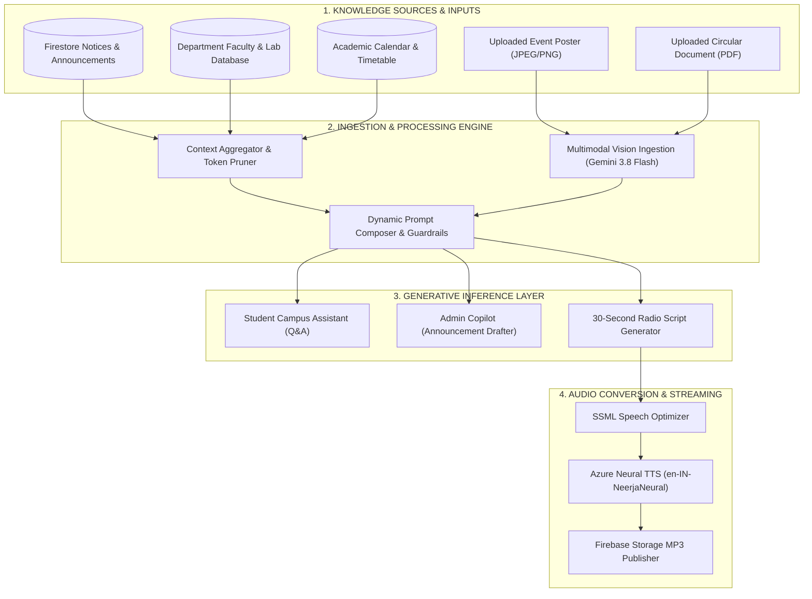
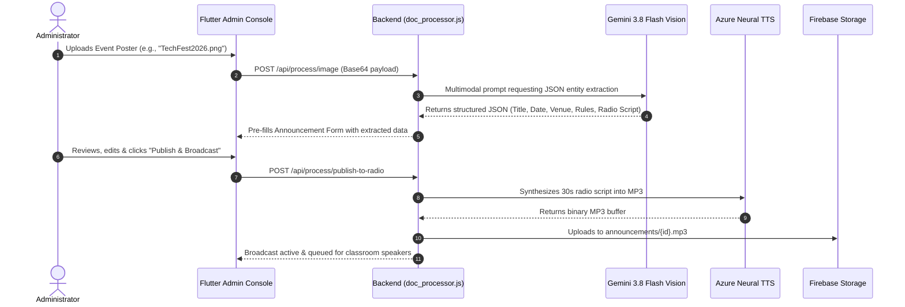

# AI RAG & Multimodal Intelligence Pipeline
## Google Gemini 3.8 Flash & Azure Cognitive Neural TTS

---

## 1. Subsystem Architecture Overview

The system incorporates dual generative AI pipelines:
1. **Gemini 3.8 Flash Retrieval-Augmented Generation (RAG):** Contextual reasoning over campus databases, notices, timetables, and department faculty directories.
2. **Multimodal Computer Vision Engine:** OCR and structured entity extraction from physical event posters, circulars, and administrative PDFs.
3. **Azure Cognitive Neural Text-to-Speech:** High-clarity Indian English (`en-IN-NeerjaNeural`) voice synthesis optimized for indoor classroom acoustics.



---

## 2. Gemini RAG Grounding Strategy

To prevent hallucinations, the backend queries the most recent Firestore collections on each request and constructs a dynamically grounded system prompt.

### Prompt Template Construction
```
================ SYSTEM PROMPT (CAMPUS ASSISTANT) ================
You are the official AI Campus Assistant for Vemana Institute of Technology.
Answer student questions accurately using ONLY the verified context below.
Format your responses in clean GitHub Markdown with clear headings (###),
bold text for dates/deadlines, and bullet points.

VERIFIED CAMPUS CONTEXT:
1. Active Notices:
   - [NOTICE #1] {title}: {content} (Date: {date})
   - [NOTICE #2] {title}: {content} (Date: {date})
2. Campus Radio Schedule:
   - Morning Show (08:30 AM IST)
   - Afternoon Pulse (01:15 PM IST)
   - Evening Recap (04:30 PM IST)
3. Faculty & Departments:
   - CSE HOD: Dr. ...
   - ISE HOD: Dr. ...
==================================================================
```

---

## 3. Multimodal Document Processing Flowchart

When an administrator uploads an image flyer or official college PDF:



---

## 4. UI Markdown Rendering Best Practices

To ensure flawless typographic presentation in the Flutter UI without raw formatting symbols:

1. **Headings (`#`, `##`, `###`):** Rendered as distinct typographic blocks with bold primary colors (`#1E1B4B`), increased font size (`15.5px`–`17.5px`), and vertical padding.
2. **Dividers (`---`, `***`):** Rendered as clean, subtle horizontal rules (`Divider(color: #E5E7EB)`).
3. **Numbered & Bulleted Lists:** Rendered with custom icon badges or bullet circles with aligned text.
4. **Emoji Sanitization:** All raw emoji characters are stripped from speech synthesis pipelines and converted into standard vector icons in the UI to prevent synthesis artifacts.
