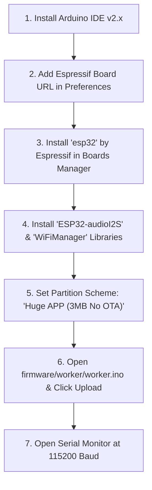
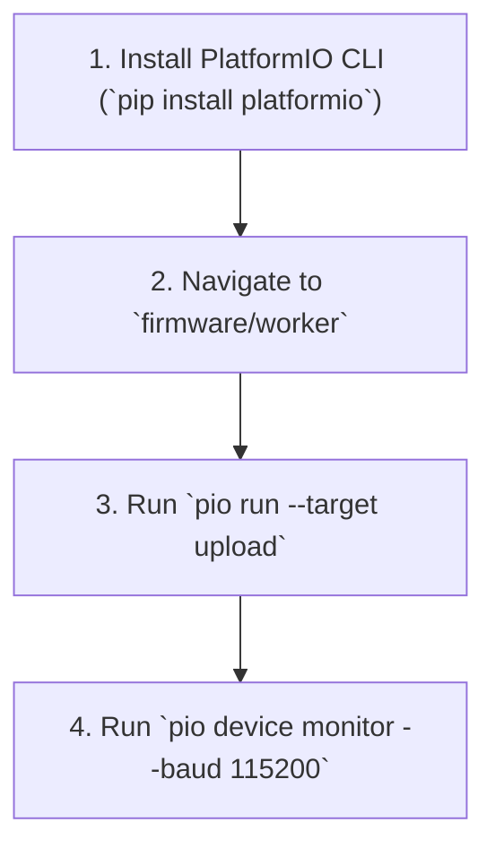

# 🚀 ESP32 First-Time Flashing & Firmware Upload Guide
## Step-by-Step Walkthrough for Arduino IDE & Terminal / PlatformIO CLI

This comprehensive guide covers everything required to flash the **Campus Radio & Announcement Smart Speaker firmware** onto a fresh ESP32 board for the very first time.

---

## 📋 Table of Contents
1. [Prerequisites & USB Driver Installation](#1-prerequisites--usb-driver-installation)
2. [Method A: Flashing via Arduino IDE (GUI / `.ino`)](#2-method-a-flashing-via-arduino-ide-gui--ino)
3. [Method B: Flashing via Terminal / PlatformIO CLI (`.cpp`)](#3-method-b-flashing-via-terminal--platformio-cli-cpp)
4. [Hardware Bootloader Mode (Troubleshooting `Connecting...___`)](#4-hardware-bootloader-mode-troubleshooting-connecting)
5. [First Boot Verification & Serial Log Output](#5-first-boot-verification--serial-log-output)
6. [Common Errors & Troubleshooting Matrix](#6-common-errors--troubleshooting-matrix)

---

## 1. Prerequisites & USB Driver Installation

Most ESP32 Dev Boards (NodeMCU, ESP32-WROOM-32, DOIT ESP32, TTGO) use either a **Silicon Labs CP2102/CP2104** or a **WCH CH340/CH9102** USB-to-UART bridge chip.

### Download Official Drivers (If ESP32 is not detected in Port menu)
* **CP210x Driver (Silicon Labs):** [Download CP210x VCP Drivers](https://www.silabs.com/developers/usb-to-uart-bridge-vcp-drivers)
* **CH340 / CH341 Driver (WCH):** [Download CH340 Driver](http://www.wch-ic.com/downloads/CH341SER_ZIP.html)
* **Mac Users (macOS Sonoma / Ventura):** Most ESP32 boards work out-of-the-box. Ensure your USB cable supports **Data + Power** (not a charge-only cable).

---

## 2. Method A: Flashing via Arduino IDE (GUI / `.ino`)



### Step 1: Install Arduino IDE
Download and install **Arduino IDE 2.3+** from the [Official Arduino Website](https://www.arduino.cc/en/software).

### Step 2: Add ESP32 Official Board Package URL
1. Open **Arduino IDE**.
2. Go to **File → Preferences** (or **Arduino IDE → Settings** on macOS).
3. In **Additional boards manager URLs**, paste the official Espressif link:
   ```text
   https://raw.githubusercontent.com/espressif/arduino-esp32/gh-pages/package_esp32_index.json
   ```
4. Click **OK**.

### Step 3: Install the ESP32 Board Core
1. In the left sidebar, click the **Boards Manager** icon (or go to **Tools → Board → Boards Manager...**).
2. Search for `esp32`.
3. Locate **esp32 by Espressif Systems** and click **Install** (Version `2.0.14` or `3.0.x`).

### Step 4: Install Required Libraries
Open **Tools → Manage Libraries...** (or press `Ctrl+Shift+I` / `Cmd+Shift+I`) and install:

| Library Name | Author | Recommended Version | Purpose |
| :--- | :--- | :---: | :--- |
| **`ESP32-audioI2S`** | *schreibfaul1* | `v3.0.12` or latest | Hardware I2S MP3 streaming & decoding |
| **`WiFiManager`** | *tzapu* | `v2.0.17` or latest | Captive portal & Wi-Fi provisioning |

*Optional direct GitHub links:*
* [schreibfaul1/ESP32-audioI2S GitHub](https://github.com/schreibfaul1/ESP32-audioI2S)
* [tzapu/WiFiManager GitHub](https://github.com/tzapu/WiFiManager)

### Step 5: Configure Board Settings in Tools Menu (CRITICAL)
In the **Tools** menu, configure the following settings:

```
+-----------------------------------------------------------------------------------------+
|                              ARDUINO IDE TOOLS MENU CONFIGURATION                       |
+---------------------+-------------------------------------------------------------------+
| Option              | Setting Value                                                     |
+---------------------+-------------------------------------------------------------------+
| Board               | "ESP32 Dev Module" (or your specific board model)                |
| Partition Scheme    | "Huge APP (3MB No OTA / 1MB SPIFFS)" <--- CRITICAL (Avoids OOM)   |
| Flash Frequency     | "80MHz"                                                           |
| Flash Mode          | "QIO" or "DIO"                                                    |
| Upload Speed        | "460800" (or 921600 for fast flashing, 115200 for stability)      |
| Core Debug Level    | "Info" (or "None")                                                |
| Port                | Select your USB Port:                                             |
|                     | - macOS: /dev/cu.usbserial-XXXX or /dev/cu.wchusbserial-XXXX      |
|                     | - Windows: COM3, COM4, COM5, etc.                                 |
+---------------------+-------------------------------------------------------------------+
```

> [!IMPORTANT]
> **Why 'Huge APP' Partition Scheme is Mandatory:**
> The `ESP32-audioI2S` and `WiFiManager` libraries with TLS SSL security require approximately 1.2MB of flash. The default Arduino partition allocates only 1.2MB for the app, causing a compilation overflow error. Selecting **`Huge APP (3MB No OTA / 1MB SPIFFS)`** solves this completely.

### Step 6: Open and Upload Firmware
1. Open [`firmware/worker/worker.ino`](file:///Users/junaid/Desktop/AT/Announcement-system/firmware/worker/worker.ino) in Arduino IDE.
2. Click the **Upload (➡️)** button in the top toolbar.
3. Wait for the terminal to display:
   ```text
   Writing at 0x00010000... (100 %)
   Wrote 1245184 bytes (731201 compressed) at 0x00010000 in 18.2 seconds...
   Hash of data verified.
   Leaving...
   Hard resetting via RTS pin...
   ```

### Step 7: Open Serial Monitor
1. Click **Tools → Serial Monitor** (or top-right magnifying glass).
2. Set the baud rate to **`115200 baud`**.
3. Press the **EN / RESET** button on your ESP32 board to observe the boot logs.

---

## 3. Method B: Flashing via Terminal / PlatformIO CLI (`.cpp`)

For automated CLI workflows or developers using VS Code / PlatformIO:



### Step 1: Install PlatformIO Core (CLI)
If not already installed:
```bash
# Via Python pip (Universal)
pip install platformio

# Or via Homebrew (macOS)
brew install platformio
```

### Step 2: Navigate to Firmware Directory
```bash
cd /Users/junaid/Desktop/AT/Announcement-system/firmware/worker
```

### Step 3: Inspect `platformio.ini`
The pre-configured [platformio.ini](file:///Users/junaid/Desktop/AT/Announcement-system/firmware/worker/platformio.ini) automatically downloads dependencies and configures the `huge_app.csv` partition:

```ini
[platformio]
default_envs = esp32dev
src_dir = src

[env:esp32dev]
platform = espressif32
board = esp32dev
board_build.partitions = huge_app.csv
framework = arduino
monitor_speed = 115200
upload_speed = 460800
lib_deps =
    https://github.com/schreibfaul1/ESP32-audioI2S.git#3.0.12
    https://github.com/tzapu/WiFiManager.git#v2.0.17
build_flags = 
    -std=gnu++2a
    -DCORE_DEBUG_LEVEL=1
```

### Step 4: Compile and Upload
Run the following command in your terminal:
```bash
pio run --target upload
```
*PlatformIO will automatically detect the connected ESP32 port, download libraries, compile C++ sources, and flash the binary.*

### Step 5: Start Serial Monitor
```bash
pio device monitor --baud 115200
```

---

## 4. Hardware Bootloader Mode (Troubleshooting `Connecting...___`)

On certain budget ESP32 boards (without auto-reset circuitry), the uploader might stall with:
```text
Connecting........_____....._____....._____.....
A fatal error occurred: Failed to connect to ESP32: Timed out waiting for packet header
```

### How to Force Bootloader Mode Manually:
1. When you see `Connecting........_____` appear in the upload terminal:
2. **Press and HOLD the `BOOT` button** on the ESP32 board.
3. Keep holding until the percentage counter begins uploading (`Writing at 0x00010000... 10%`).
4. **Release the `BOOT` button**.

```
                   +----------------------------+
                   |        ESP32 BOARD         |
                   |                            |
                   |  [ EN / RST ]    [ BOOT ]  |
                   |      (O)           (O) <---+--- Hold when 'Connecting...' appears
                   |                            |
                   |         [MicroUSB]         |
                   +----------------------------+
```

---

## 5. First Boot Verification & Serial Log Output

Once flashed, open your Serial Monitor at **115200 baud** and reboot the board. You should observe the following sequence:

```text
==========================================
   AI CAMPUS RADIO - SMART SPEAKER NODE   
==========================================
[Boot] Chip Model: ESP32-D0WDQ6 (Revision 1)
[Boot] Hardware MAC Address: 08:A6:F7:5A:A5:D8
[Boot] Audio Pinout: LRC=25, BCLK=26, DIN=27

[Wi-Fi] Initializing network connection...
[Wi-Fi] Connected successfully to campus network!
[Wi-Fi] Assigned IP Address: 192.168.1.145
[Wi-Fi] Signal Strength (RSSI): -54 dBm

[Firestore] Resolving classroom mapping for MAC: 08:A6:F7:5A:A5:D8...
[Firestore] Matched Classroom: Seminar Hall 1
[Heartbeat] Sent active heartbeat to /classrooms/Seminar Hall 1

[System] Node is ONLINE and listening for voice broadcasts...
```

---

## 6. Common Errors & Troubleshooting Matrix

| Error Message | Root Cause | Solution |
| :--- | :--- | :--- |
| `Sketch too big / Flash overflow` | Default 1.2MB partition selected in Arduino IDE | In **Tools → Partition Scheme**, select **`Huge APP (3MB No OTA / 1MB SPIFFS)`**. |
| `Failed to connect to ESP32: Timed out` | Missing USB drivers or board didn't auto-enter flash mode | Install CP2102/CH340 drivers. Hold the physical **BOOT button** when `Connecting...` appears. |
| `Audio.h: No such file or directory` | `ESP32-audioI2S` library not installed | In Library Manager, install **`ESP32-audioI2S` by *schreibfaul1***. |
| `WiFiManager.h: No such file or directory` | `WiFiManager` library not installed | In Library Manager, install **`WiFiManager` by *tzapu***. |
| `Brownout detector was triggered` | Insufficient USB power during Wi-Fi transmission bursts | Connect ESP32 to a powered USB 3.0 port or 5V 2A external DC power adapter. |
| `Guru Meditation Error / OOM Crash` | Unbounded JSON memory leak | Ensure you are flashing the latest code from `firmware/worker/src/main.cpp` using `documents:runQuery`. |
