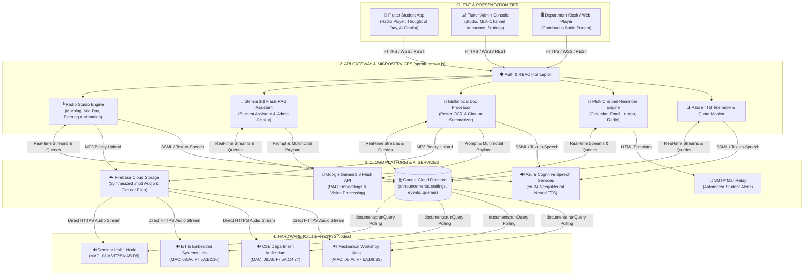
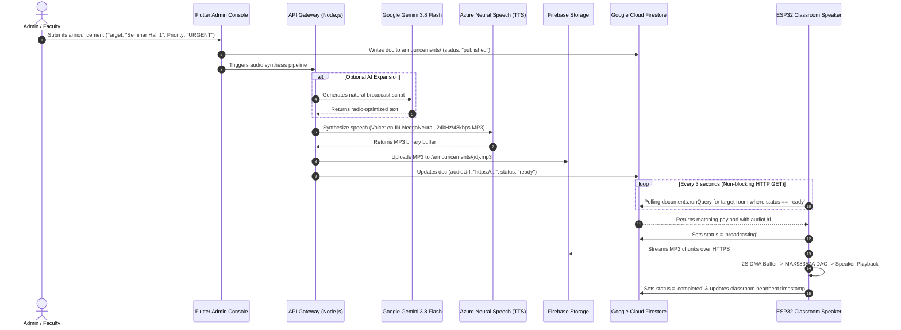
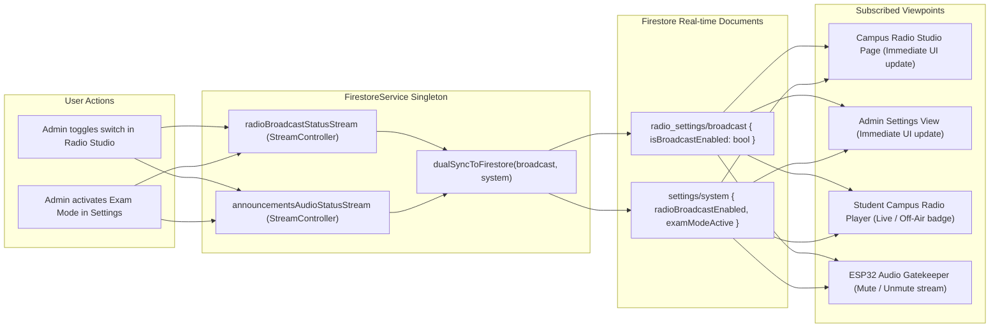
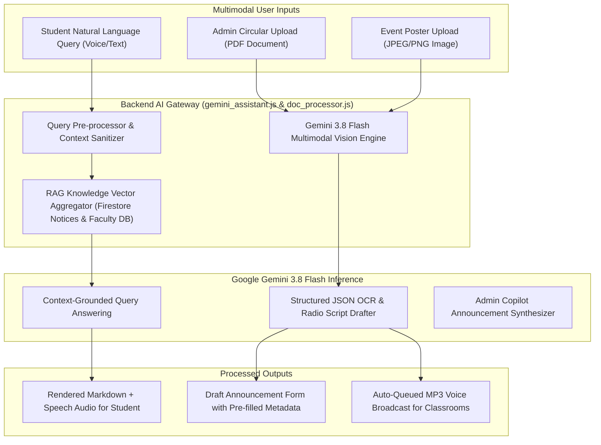

# System Architecture & Technical Design Specification
## AI-Powered Campus Radio & Smart Announcement System

---

## 1. Executive Summary & Architectural Goals

The **AI-Powered Campus Radio & Smart Announcement System** is an enterprise-grade, IoT-driven audio broadcasting and multimodal intelligence platform designed for higher education campuses. It bridges administrative announcements, automated daily campus radio shows, Google Gemini 3.8 Flash RAG AI assistance, multimodal circular/poster digitization, and decentralized ESP32 I2S hardware speaker nodes over low-latency Wi-Fi.

### Core Architectural Principles
* **Low Latency & High Availability (HA):** Sub-second dispatching of voice alerts across campus nodes.
* **Dual-Band State Synchronization:** Real-time reactive sync across admin consoles, student apps, and hardware nodes using Firestore and dual-stream broadcast controllers.
* **Cost & Quota Efficiency:** Azure Neural TTS optimization with intelligent caching, token budgeting, and real-time telemetry against free-tier (500k char/month) limits.
* **Hardware Resilience:** Decentralized ESP32 firmware running non-blocking FreeRTOS audio pipelines with structured JSON `documents:runQuery` REST polling to prevent heap exhaustion.
* **Strict Role-Based Access Control (RBAC):** Principle of Least Privilege across Superadmin, Admin/Faculty, and Student tiers.

---

## 2. End-to-End System Block Diagram



---

## 3. High-Level Announcement & Audio Processing Lifecycle



---

## 4. Multi-Channel Campus Radio Architecture

The Campus Radio engine operates as an autonomous multi-schedule broadcast hub with manual administrative override capabilities:

### Daily Program Schedule Matrix
```
+-----------------------------------------------------------------------------------------+
|                               CAMPUS RADIO DAILY AUTOMATION                             |
+---------------------+-------------------+-----------------------+-----------------------+
| Show Type           | Scheduled Time    | Primary Content       | Target Outputs        |
+---------------------+-------------------+-----------------------+-----------------------+
| Morning Chronicle   | 08:30 AM IST      | Thought of the Day,   | All Classroom Nodes,  |
|                     |                   | Timetable, Deadlines  | Student Mobile App    |
+---------------------+-------------------+-----------------------+-----------------------+
| Mid-Day Pulse       | 01:15 PM IST      | Placement Drives,     | Campus Kiosks,        |
|                     |                   | Hackathons, Alerts    | In-App Live Stream    |
+---------------------+-------------------+-----------------------+-----------------------+
| Evening Roundup     | 04:30 PM IST      | Next-Day Previews,    | Department Speakers,  |
|                     |                   | Lab Schedules, Recap  | Mobile Web Player     |
+---------------------+-------------------+-----------------------+-----------------------+
```

### Real-Time State Synchronization Engine

To guarantee zero discrepancy between the **Radio Studio**, **Admin Settings**, **Student UI**, and **Classroom Speakers**, a dual-layer synchronization pipeline is implemented:



---

## 5. Google Gemini 3.8 Flash RAG & Multimodal Pipeline

The intelligence subsystem combines Retrieval-Augmented Generation (RAG) with multimodal computer vision:



---

## 6. Hardware & Audio Pipeline Specification

### ESP32 I2S DAC Pinout Mapping
* **Microcontroller:** ESP32-WROOM-32D / ESP32-DevKitC (240MHz Dual-Core, 520KB SRAM).
* **Audio DAC Amplifier:** MAX98357A (Mono 3.2W Class D) or PCM5102 (Stereo Hi-Fi).

| ESP32 Pin (GPIO) | DAC Signal Name | Description |
| :--- | :---: | :--- |
| **GPIO 25** | `LRC` / `WS` | Left/Right Word Select Clock |
| **GPIO 26** | `BCLK` / `SCK` | Continuous Bit Clock Line |
| **GPIO 27** | `DIN` / `SDATA`| Serial Audio Data Stream |
| **5V / VIN** | `VDD` / `VIN` | Regulated Power Supply |
| **GND** | `GND` | Common Ground Reference |
| **GPIO 0** | `BOOT` | Wi-Fi Provisioning Trigger (Hold 5s) |
| **GPIO 2** | `STATUS LED` | System Health Indicator (Blink: Setup, Solid: Online) |

### Memory & Execution Profiling on ESP32
* **Heap Allocation Strategy:** Pre-allocated 32KB circular DMA audio ring buffer.
* **Network Query Footprint:** `documents:runQuery` payload is constrained to **1.5 KB** per poll cycle, avoiding the memory crash typical of unbounded 300KB Firestore collection dumps.
* **Watchdog Integration:** FreeRTOS task watchdog resets audio tasks upon connection dropouts.

---

## 7. Security, Access Control & Compliance

1. **Authentication:** Firebase Authentication with token expiration and JWT claim verification.
2. **Firestore Rules:** Strict collection isolation:
   * `/announcements/{id}`: Read public; Write restricted to authenticated faculty/admin.
   * `/settings/{id}`: Read/Write restricted to `superadmin`.
   * `/queries/{id}`: Read/Write scoped to student author and admin responders.
3. **Wi-Fi Provisioning Security:**
   * Hotspot disabled during standard operation.
   * Physical button hold (5 seconds) required to activate WPA2 captive portal (`CampusRadio-Setup-<MAC>`).
   * 180-second automatic timeout watchdog.
