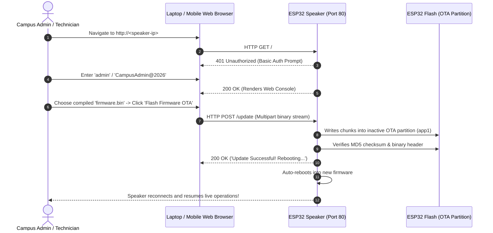

# 📶 ESP32 Dual-Mode Wi-Fi Provisioning & Wireless OTA Updates Guide

This guide explains how to dynamically configure Wi-Fi network credentials and perform **Over-The-Air (OTA) wireless firmware updates** on the **Campus Radio ESP32 Smart Speakers** without opening the physical speaker enclosure, touching firmware source code, or connecting USB cables.

---

## 🎯 3 Provisioning & Configuration Channels

The speaker firmware supports **three complementary configuration channels** designed for maximum convenience and enterprise security:

| Channel | When to Use | How to Access | Security |
| :--- | :--- | :--- | :--- |
| **1. Local In-Speaker Web Console & OTA** | While speaker is online & mounted inside box | Browse to `http://<speaker-ip>` on campus LAN | HTTP Basic Auth (`admin` / `CampusAdmin@2026`) |
| **2. Autonomous SoftAP Watchdog** | When Wi-Fi drops / router credentials changed (>30s) | Connect to `CampusRadio-Speaker-XXXX` on `192.168.4.1` | WPA2 (`CampusAdmin@2026`) + Basic Auth |
| **3. Physical BOOT Button Portal** | First-time bench provisioning or hard reset | Hold physical `BOOT` button (GPIO 0) for 5s | WPA2 (`CampusAdmin@2026`) + 180s Watchdog |

---

## 🚀 Wireless Firmware Updates Over-The-Air (OTA)

When speakers are sealed inside physical classroom acoustic enclosures or ceiling mounts, updating firmware via USB cables is impractical. The ESP32 includes **Web Browser OTA updating**:

### How to Flash New Firmware Over Wi-Fi:
1. Export the compiled binary file:
   - In PlatformIO: Run `pio run` (generated in `.pio/build/esp32dev/firmware.bin`).
   - In Arduino IDE: Click **Sketch → Export Compiled Binary** (generates `.bin` file in sketch folder).
2. Open `http://<speaker-ip>` in your browser.
3. Authenticate with:
   - **Username**: `admin`
   - **Password**: `CampusAdmin@2026`
4. Under **🚀 Wireless Firmware Update (OTA)**:
   - Click **Choose File** and select `firmware.bin`.
   - Click **Flash Firmware OTA**.
5. The ESP32 streams the binary directly into flash memory (~10 seconds), verifies integrity, and automatically reboots into the new version.

---

## 🔒 Security Architecture (4-Layer Defense)

To prevent unauthorized tampering by students or unauthorized users, the speaker implements a strict **4-layer commercial security model**:

1. **HTTP Basic Authentication (`admin` / `CampusAdmin@2026`)**:
   - The embedded Web Console requires authentication for every view, Wi-Fi save, remote reboot, and OTA update.
2. **WPA2-Encrypted Hotspots**:
   - Both the fallback SoftAP and the on-demand setup portal are protected with WPA2-PSK encryption:
     - **Fallback SoftAP SSID**: `CampusRadio-Speaker-<Last4MAC>`
     - **On-Demand Setup SSID**: `CampusRadio-Setup-<Last4MAC>`
     - **Password**: `CampusAdmin@2026`
3. **Flash ROM Zero-Heap Storage (`PROGMEM`)**:
   - The Web Console HTML is stored directly in Flash ROM, consuming **0 bytes of dynamic heap RAM** to prevent memory fragmentation and ensure 100% stability during 24/7 audio streaming.
4. **180-Second Auto-Shutdown Watchdog**:
   - If manual setup mode is triggered but no new credentials are saved within 3 minutes (180s), the hotspot turns off automatically and the speaker returns to normal playback mode.

---

## 🛠️ Method 1: Local In-Speaker Web Console (`http://<speaker-ip>`)

*Ideal for changing Wi-Fi credentials or checking signal strength without opening the physical speaker box.*

1. Identify the speaker's IP address (visible on the **Admin Dashboard > Hardware Diagnostics** tab or your campus router DHCP table).
2. Open any web browser on the campus network and visit `http://<speaker-ip>`.
3. When prompted for credentials, enter:
   - **Username**: `admin`
   - **Password**: `CampusAdmin@2026`
4. The **Speaker Console** displays live telemetry:
   - Mapped Classroom Name
   - MAC Address & Local IP Address
   - Active Wi-Fi SSID and Signal Strength (RSSI in dBm)
5. Enter the new **Wi-Fi SSID** and **Password**, then click **Save & Reconnect**.
6. The speaker will save credentials to Flash memory and reboot immediately into the new network.

---

## 🚨 Method 2: Autonomous SoftAP Fallback Watchdog

*Ideal when campus Wi-Fi credentials change or the router is offline and the speaker is sealed in an acoustic box.*

1. If the ESP32 loses its Wi-Fi connection for **longer than 30 seconds**, the firmware's autonomous watchdog automatically activates an emergency configuration SoftAP.
2. The speaker broadcasts:
   - **SSID**: `CampusRadio-Speaker-<Last4MAC>` (e.g., `CampusRadio-Speaker-A5D8`)
   - **Password**: `CampusAdmin@2026`
   - **Gateway IP**: `192.168.4.1`
3. Connect your laptop or phone to `CampusRadio-Speaker-<Last4MAC>`.
4. Open your browser and navigate to `http://192.168.4.1`.
5. Enter HTTP credentials (`admin` / `CampusAdmin@2026`).
6. Update Wi-Fi credentials or flash OTA firmware, then tap **Save & Reconnect**.

---

## 🔘 Method 3: Physical BOOT Button Setup Portal

*Ideal for first-time unboxed bench provisioning or manual hard resets.*

1. Locate the physical **BOOT button (GPIO 0)** on the ESP32 DevKit board.
2. Press and hold the BOOT button for **5 seconds**.
3. The onboard **Blue LED** blinks rapidly, confirming setup mode.
4. The speaker spins up `CampusRadio-Setup-<Last4MAC>` on `192.168.4.1` (Password: `CampusAdmin@2026`).
5. Connect to the hotspot; the Captive Portal opens automatically (or visit `http://192.168.4.1`).
6. Select your campus Wi-Fi network from the scan list, enter the password, and tap **Save**.
7. The device saves credentials to NVS Flash memory and reboots.
