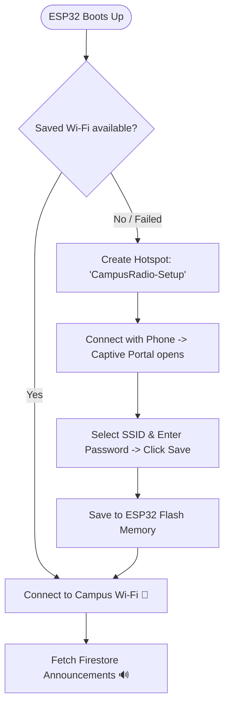

# 📶 ESP32 Dynamic Wi-Fi Provisioning: Architectural Options

This document outlines the four primary architectural approaches for dynamically configuring and updating Wi-Fi credentials on the **Campus Radio ESP32 Smart Speakers** without requiring firmware re-flashing or USB cables.

---

## 📊 Comprehensive Options Comparison

| Option | How It Works | Configuration Flow (How User Sets Wi-Fi) | Key Advantages | Limitations / Trade-offs | Implementation Effort | Recommended Use Case |
| :--- | :--- | :--- | :--- | :--- | :---: | :--- |
| **1. Wi-Fi Captive Portal (`WiFiManager`)** ⭐ *(Top Pick)* | When connection fails, ESP32 broadcasts a temporary hotspot (`CampusRadio-Speaker-Setup`). Saves credentials to non-volatile flash memory (NVS). | 1. Connect phone to ESP32 hotspot.<br>2. Captive portal auto-opens in browser.<br>3. Select SSID, enter password, click Save.<br>4. ESP32 reconnects automatically. | • Zero code re-flashing needed.<br>• Works on any phone/laptop without special apps.<br>• Includes physical BOOT button reset (hold 5s to clear). | Adds ~15KB flash footprint (well within 4MB ESP32 capacity). | **Low**<br>(~15 mins) | **Production deployments, non-technical campus staff, moving speakers between buildings.** |
| **2. Multi-SSID Fallback (`WiFiMulti`)** | Pre-configures a prioritized list of 3–5 campus/lab networks in code. Auto-scans and connects to whichever is in range. | Completely automatic — no user action. Connects to strongest pre-saved Wi-Fi. | • Zero configuration required.<br>• Instant fallback if a primary router goes down.<br>• Lightweight and simple. | Cannot connect to a brand new/unlisted Wi-Fi network without updating the list in code. | **Very Low**<br>(~5 mins) | **Controlled lab environments with fixed known routers & backup phone hotspots.** |
| **3. Mobile App BLE Provisioning (Bluetooth LE)** | ESP32 advertises over Bluetooth LE. The Flutter Admin App detects the speaker and pushes Wi-Fi credentials wirelessly. | 1. Open Flutter Admin App.<br>2. Tap *"Configure Nearby Speaker"*.<br>3. App sends Wi-Fi credentials over Bluetooth. | • Seamless native experience inside your existing mobile app.<br>• Highly professional presentation. | • Requires BLE integration on both Flutter & ESP32.<br>• Uses ~40KB more RAM during Bluetooth pairing. | **Medium–High**<br>(~1–2 days) | **Commercial IoT products with branded mobile companion apps.** |
| **4. SD Card / Flash Config File (`config.json`)** | ESP32 reads `config.json` containing Wi-Fi credentials from an SD card or internal LittleFS storage partition. | Edit a JSON text file on an SD card or upload via local web interface. | • Keeps code and credentials separated.<br>• Easy batch provisioning with pre-configured SD cards. | Requires physical SD card module hardware or local file upload. | **Medium**<br>(~1 hour) | **Industrial installations using pre-flashed micro-SD cards.** |

---

## 🛠️ Detailed Workflows

### Option 1: Wi-Fi Captive Portal (`WiFiManager`) — *Recommended*



#### Key Features:
- **On-Demand Configuration**: If the router password changes, the ESP32 automatically starts its access point so anyone nearby can update it in 10 seconds.
- **Physical Reset Button**: Holding down the onboard **BOOT button** for 5 seconds clears saved credentials and enters setup mode.
- **Silent Boot**: When credentials are unchanged, connects directly to Wi-Fi in $< 2$ seconds with no hotspot broadcast.

---

### Option 2: Multi-SSID Fallback (`WiFiMulti`)

#### Code Example:
```cpp
#include <WiFiMulti.h>
WiFiMulti wifiMulti;

void setup() {
    wifiMulti.addAP("Excitel_AARIV TECHNOLOGY ", "1286793808");
    wifiMulti.addAP("College_Campus_WiFi", "CampusPass@2026");
    wifiMulti.addAP("IoT_Lab_Router", "LabSecure99");
    wifiMulti.addAP("Mobile_Hotspot", "hotspot123");

    while (wifiMulti.run() != WL_CONNECTED) {
        delay(500);
    }
}
```

---

## 🎯 Executive Recommendation

1. **Phase 1 (Immediate)**: If you just need a reliable backup for presentations/demos, add **Option 2 (`WiFiMulti`)** to include both the campus Wi-Fi and your phone's personal hotspot.
2. **Phase 2 (Long-term / Final Product)**: Implement **Option 1 (`WiFiManager`)** so campus technicians can deploy speaker units anywhere in the college without needing assistance from developers.
