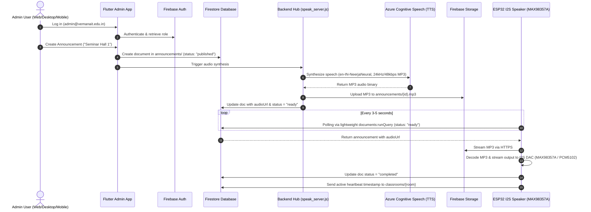
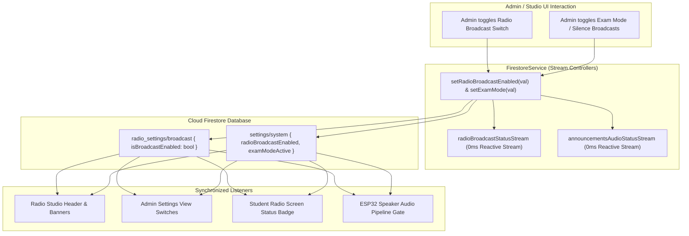

# AI Campus Radio & Smart Announcement System
## System Architecture Specification

---

## 1. System Architecture Overview

The system operates across four primary architectural tiers:
1. **Presentation & Client Tier:** Flutter-based multi-platform application (Web, Android, iOS, macOS).
2. **API Gateway & Microservices Tier:** Node.js Express server orchestrating AI models, audio conversion, and event dispatchers.
3. **Cloud & AI Subsystems Tier:** Firebase Auth, Google Cloud Firestore, Firebase Storage, Google Gemini 3.8 Flash RAG, and Azure Cognitive Neural Speech.
4. **IoT & Edge Hardware Tier:** Decentralized ESP32 microcontrollers with I2S DACs (MAX98357A / PCM5102) and hardware speakers.

---

## 2. End-to-End System Flowchart

```text
                      +-----------------------------+
                      |  1. Admin App (Flutter UI)  |
                      +-----------------------------+
                                     |
                                     | (Writes Text & Target Class)
                                     v
                      +-----------------------------+
                      |    2. Firestore Database    |
                      +-----------------------------+
                                     |
                                     | (Triggers Cloud Event / Direct API)
                                     v
                      +-----------------------------+       +-------------------------------+
                      | 3. Cloud Function (Node.js) | <===> | Azure Speech Services TTS API |
                      +-----------------------------+       | (Converts Text to MP3)        |
                                     |                      +-------------------------------+
                                     | (Uploads MP3 & sets status: ready)
                                     v
                      +-----------------------------+
                      | 4. Firebase Storage (.mp3)  |
                      +-----------------------------+
                                     ^
                                     |
                                     | (Pulls audio stream over Wi-Fi)
                                     |
                      +-----------------------------+
                      | 5. ESP32 Worker Speaker     | <===> [ MAX98357A Amp + Speaker ]
                      +-----------------------------+
```

---

## 3. Detailed Sequence Diagram



---

## 4. Real-Time State Synchronization Flow



---

## 5. Hardware Specifications & Pinout Configuration

### ESP32 I2S DAC Pinout Mapping
* **Microcontroller:** ESP32 Dev Module (Dual Core 240MHz).
* **I2S DAC:** MAX98357A / PCM5102.
  * `LRC / WS`: **GPIO 25**
  * `BCLK`: **GPIO 26**
  * `DIN / DOUT`: **GPIO 27**
* **Audio Library:** `ESP32-audioI2S` (stable v3.0.12).
* **Memory Footprint:** RAM ~15.3% (50KB used), Flash ~93.8% (1.2MB).
* **Firestore Polling Engine:** Uses structured `documents:runQuery` REST API (1.5KB payload vs 290KB unbounded GET) for leak-free, non-blocking queue execution.

---

## 6. Full Documentation References

* [System Architecture & Technical Design Specification](file:///Users/junaid/Desktop/AT/Announcement-system/docs/system_architecture_and_design.md)
* [REST API Reference Manual](file:///Users/junaid/Desktop/AT/Announcement-system/docs/api_reference.md)
* [Hardware Engineering & ESP32 Firmware Guide](file:///Users/junaid/Desktop/AT/Announcement-system/docs/hardware_and_firmware_guide.md)
* [Production Deployment & Operations Runbook](file:///Users/junaid/Desktop/AT/Announcement-system/docs/deployment_and_operations_guide.md)
* [AI RAG & Multimodal Intelligence Pipeline](file:///Users/junaid/Desktop/AT/Announcement-system/docs/ai_rag_and_multimodal_pipeline.md)
* [ESP32 Secure Wi-Fi Provisioning Guide](file:///Users/junaid/Desktop/AT/Announcement-system/docs/wifi_provisioning_guide.md)
